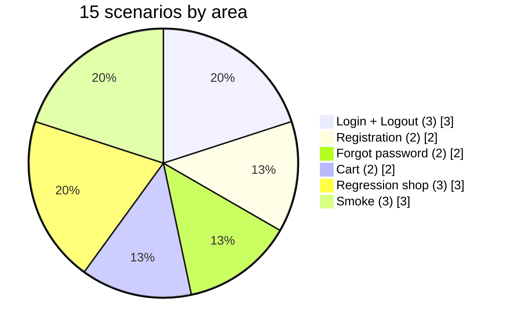
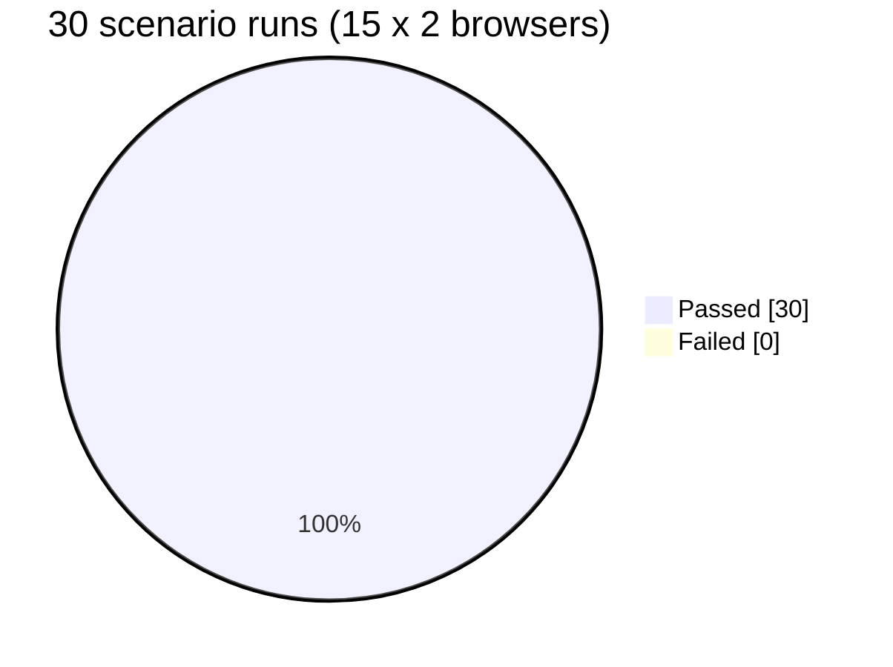
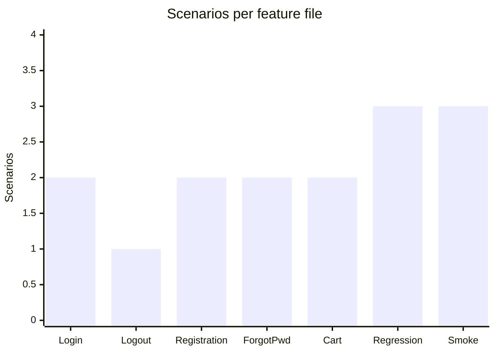
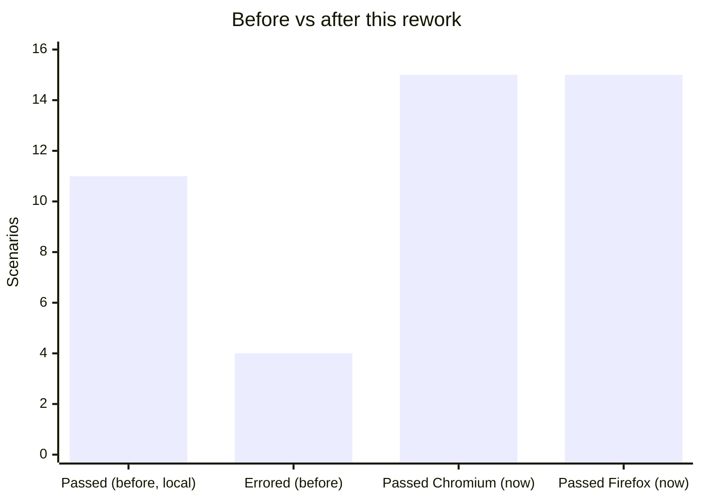
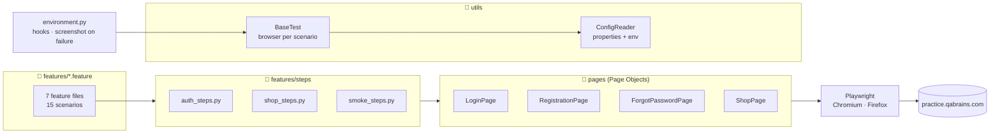
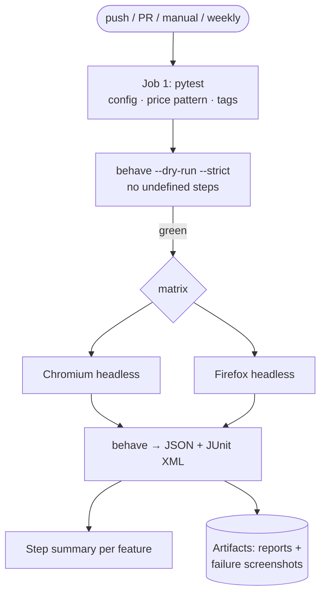
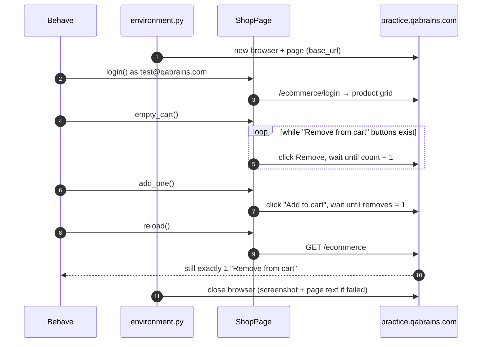
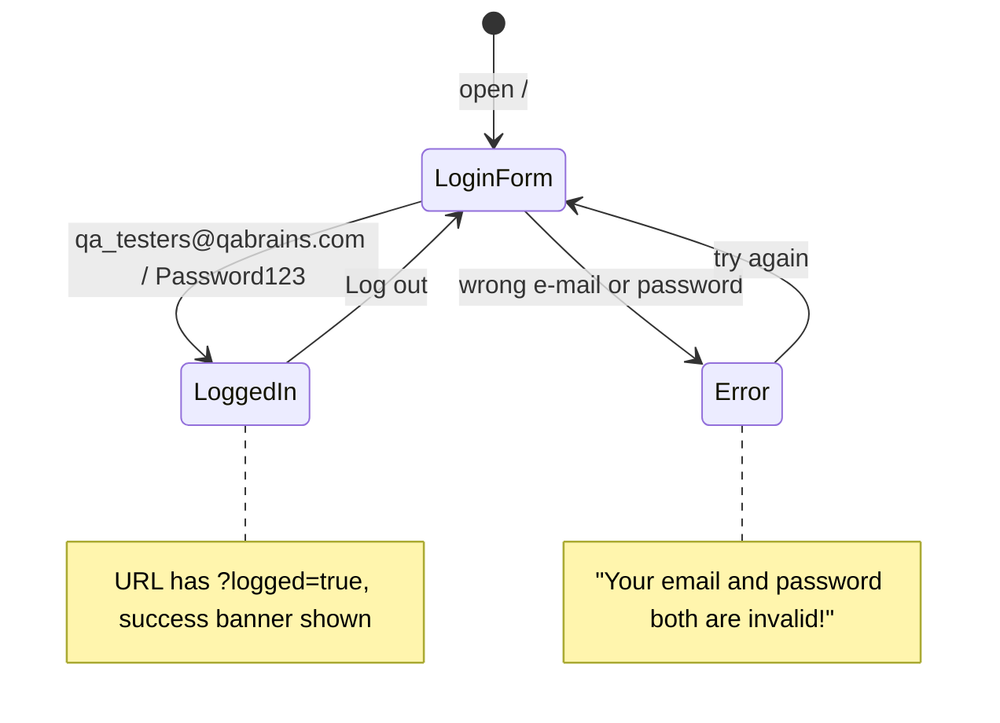
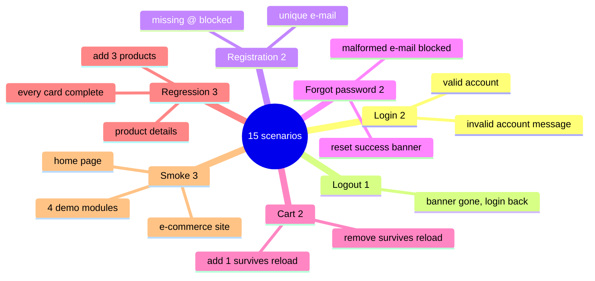

<div align="center">

# 🐍 QA Brains Automation — Python · Playwright · Behave (BDD)

### UI test automation for the QA Brains practice site. 15 Gherkin scenarios cover login, logout, registration, forgot password, the e-commerce cart and the demo modules. They run headless on Chromium and Firefox in GitHub Actions.

[](https://git.io/typing-svg)

<!-- ============ STATUS BAR ============ -->
[](https://github.com/rbchy/QaBrainsAutomationPythonPlawright/actions/workflows/ci.yml)


</div>

---

## 📌 At a Glance

<table>
<tr>
<td width="50%" valign="top">

**🙋 What this is**

A **Behave (Gherkin) + Playwright for Python** framework that tests the live **[QA Brains practice site](https://practice.qabrains.com/)**:

- the login demo: valid and invalid accounts, logout
- registration and forgot password, including the browser's own e-mail validation
- the **e-commerce demo**: adding and removing products, with the cart checked again after a reload
- product cards and details, and the sidebar demo modules

Each scenario gets a fresh browser. The suite runs **headless on Chromium and Firefox** in GitHub Actions on every push and once a week, because the live site can change. A failure saves a screenshot and prints the page text into the log.

</td>
<td width="50%" valign="top">

**📍 Quick facts**

| | |
|---|---|
| 🌐 **Site under test** | practice.qabrains.com (live) |
| 🧪 **Scenarios** | 15 in 7 feature files · 49 steps |
| 🧩 **Unit tests** | 15 (pytest, no browser) |
| 🌍 **Browsers** | Chromium · Firefox (headless in CI) |
| ⏱️ **Run time** | ≈ 51 s (Chromium) · ≈ 54 s (Firefox) |
| 🧱 **Pattern** | Page Object Model, browser per scenario |
| 📊 **Reports** | JUnit XML · Behave JSON · failure screenshots |
| 🔁 **Runs** | push · PR · manual · weekly |

</td>
</tr>
</table>

---

## ✅ Latest Results (GitHub Actions)

| Feature file | Scenarios | What is asserted | Chromium | Firefox |
|---|---:|---|:---:|:---:|
| 🔐 `Login.feature` | 2 | valid → `?logged=true` + success banner · invalid → *"Your email and password both are invalid!"*, no banner | ✅ 2 | ✅ 2 |
| 🚪 `Logout.feature` | 1 | `logged=true` gone, Login button back, no banner | ✅ 1 | ✅ 1 |
| 📝 `Registration.feature` | 2 | unique e-mail → *successfully* · e-mail without `@` blocked by the browser (`typeMismatch`) | ✅ 2 | ✅ 2 |
| 🔑 `ForgotPassword.feature` | 2 | valid → `?forgot=true` + *"Password is reset successfully"* · malformed → browser validation, no banner | ✅ 2 | ✅ 2 |
| 🛒 `CartCheckout.feature` | 2 | starts empty · add → exactly 1, still 1 after reload · remove → 0, still 0 after reload | ✅ 2 | ✅ 2 |
| 🔄 `RegressionTests.feature` | 3 | add 3 → exactly 3 · details page shows name and price · every card has name, price and one *Add to cart* | ✅ 3 | ✅ 3 |
| 💨 `SmokeTests.feature` | 3 | home login form · 5 demo modules open from the sidebar | ✅ 3 | ✅ 3 |
| **Total** | **15** | | **15 / 15** | **15 / 15** |









> **Before:** the last local run (`run_output.txt`) had 11 passed and 4 errored, and several of the 11 could not fail (see the Maintenance Log). **Now** every step asserts something concrete. The first CI run caught a real cross-browser difference: Firefox words the invalid-e-mail message differently from Chromium.

---

## 🏗️ Framework Architecture



### CI pipeline



### One scenario: the cart survives a reload



### Login state



---

## 🧪 Test Coverage



| Tag | Scenarios | Run with |
|---|---:|---|
| `@smoke` | 9 | `behave --tags=@smoke` |
| `@regression` | 12 | `behave --tags=@regression` |
| `@Login` · `@Logout` · `@Registration` · `@ForgotPassword` · `@Cart` · `@Shop` | 2 · 1 · 2 · 2 · 3 · 2 | `behave --tags=@Cart` |

---

## ▶️ Running Locally

**Prerequisites:** Python 3.10+.

```bash
python -m venv .venv && source .venv/bin/activate
pip install -r requirements.txt
python -m playwright install chromium firefox

behave                               # all 15 scenarios, headed Chromium (config.properties)
HEADLESS=true behave                 # headless
BROWSER=firefox HEADLESS=true behave # Firefox
behave --tags=@smoke                 # one tag
python -m pytest                     # unit tests for the helpers
```

| Setting | `config/config.properties` | Env var override |
|---|---|---|
| Site URL | `url` | `BASE_URL` |
| Browser | `browser=chromium` | `BROWSER` (`chromium` · `firefox` · `webkit`) |
| Headless | `headless=false` | `HEADLESS=true` |
| Timeout | `timeout=15000` (ms) | |

The accounts in `config.properties` (`qa_testers@qabrains.com`, `test@qabrains.com`, `Password123`) are the **public practice accounts published by QA Brains**.

---

## 📁 Project Structure

```text
QaBrainsAutomationPythonPlawright/
├── .github/workflows/ci.yml        # pytest → Behave on Chromium + Firefox
├── behave.ini                      # paths, JUnit output
├── config/config.properties        # URL, browser, timeout, practice accounts
├── features/
│   ├── *.feature                   # 7 feature files, 15 scenarios
│   ├── environment.py              # hooks: browser per scenario, failure capture
│   └── steps/                      # auth_steps · shop_steps · smoke_steps
├── pages/                          # LoginPage · RegistrationPage · ForgotPasswordPage · ShopPage
├── utils/                          # BaseTest · ConfigReader
├── tests/test_config_reader.py     # 15 pytest unit tests
└── requirements.txt
```

---

## 🧹 Maintenance Log

| Area | Before | Now |
|---|---|---|
| Last run | 11 passed, **4 errored** (cart × 3, login) | 15 / 15 on Chromium and Firefox |
| R-02 / R-03 | placeholders: `assert True`, quantity set to the expected value | replaced by real checks: product details, every product card |
| Smoke navigation | asserted only that the URL was not empty; jumped to `/catalog`, `/wishlist`, `/refer`, which are not on the site | clicks the real sidebar items and checks each URL |
| Cart | "added" = any element whose class contains *cart* | cart size = number of *Remove from cart* buttons, checked again after a reload |
| Forgot password | passed if the text contained `@` or *success* anywhere | exact banner, `?forgot=true`, browser validity state |
| Browser | always headed, `config.properties` ignored, URL hard-coded in 3 places | one `BaseTest`, config + env overrides, `base_url` |
| Duplicates | `BaseTest`, `DriverFactory` and `DriverHelper` all started browsers | one `BaseTest` |
| Failure evidence | screenshot only | screenshot + URL + page text in the CI log |
| Repo | `allure-results/`, `reports/`, `run_output.txt`, a stray zip of the project (`zi12CsSI`) committed | removed; `.gitignore` |
| CI | none | GitHub Actions: pytest, dry-run for undefined steps, 2-browser matrix, weekly run |

---

## 📈 Roadmap

- [x] Headless CI on Chromium and Firefox
- [x] Every step asserts something that can fail
- [ ] WebKit in the matrix
- [ ] Allure report published to GitHub Pages
- [ ] Form Submission and Drag-and-Drop demo modules covered beyond navigation
- [ ] Run scenarios in parallel (`behavex`)

---

## 🔗 Related Projects

Same site, same scenarios, other stacks:

| Repo | Stack |
|---|---|
| [QaBrainsAutomationTypeScriptPlaywright](https://github.com/rbchy/QaBrainsAutomationTypeScriptPlaywright) | TypeScript · Playwright · Cucumber |
| [QaBrainsAutomationJavaPlaywright](https://github.com/rbchy/QaBrainsAutomationJavaPlaywright) | Java · Playwright · Cucumber · TestNG |
| [QaBrainsAutomationJavaSelenium](https://github.com/rbchy/QaBrainsAutomationJavaSelenium) | Java · Selenium · Cucumber |
| [QaBrainsAutomationCypressJavaScript](https://github.com/rbchy/QaBrainsAutomationCypressJavaScript) | JavaScript · Cypress |
| [rbchy](https://github.com/rbchy/rbchy) | Profile and full project list |

---

## ⚠️ Disclaimer

Educational / portfolio project, not affiliated with QA Brains. The tests run against a public practice site, so a change there can break a scenario. That is why CI also runs weekly.

---

## 👤 Author

<div align="center">

**Ranajit Baran Chowdhury (RB Chowdhury)**
QA Automation Engineer / SDET · West Norriton, Pennsylvania, USA

[](https://www.linkedin.com/in/rbchy/)
[](https://github.com/rbchy)
[](https://rbchy.github.io/rbchy/)
[](https://rbc6543.wixsite.com/rbc-portfolio)
[](mailto:chyranajit@gmail.com)

⭐ *If this project helps you, a star on the repo is appreciated.*

</div>
